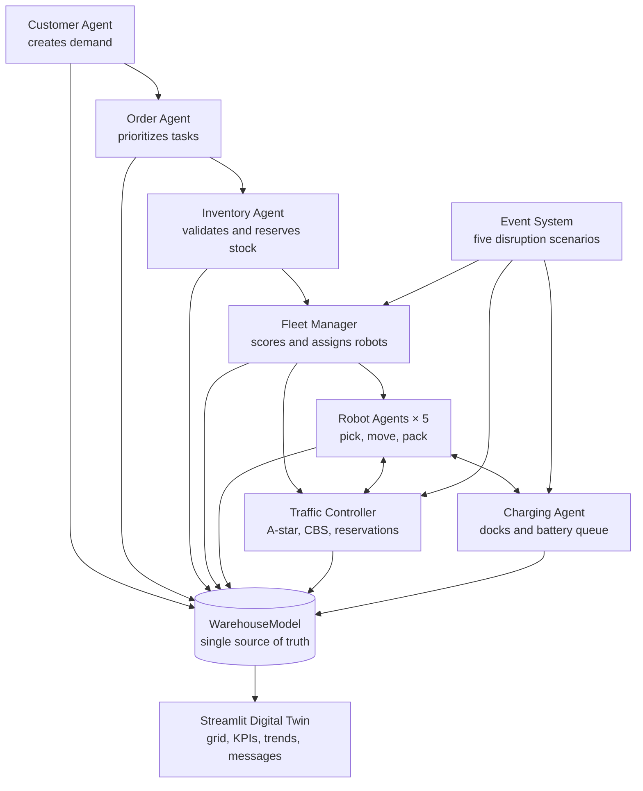

<div align="center">

# NEXUS — Autonomous Warehouse Digital Twin

### A resilient multi-agent fulfilment system that allocates, navigates, communicates, and recovers in real time

[](https://www.python.org/)
[](https://mesa.readthedocs.io/)
[](https://streamlit.io/)
[](#verification)
[](#responsible-use-and-limitations)

**[Quick start](#quick-start) · [How it works](#how-one-order-moves-through-nexus) · [Live demo](#dashboard-tour) · [Algorithms](#decision-intelligence) · [Testing](#verification) · [Full report](PROJECT_SHOWCASE_GUIDE.md)**

</div>

---

## The idea

Warehouse automation is not one decision. An incoming order changes inventory, robot assignments, traffic reservations, battery demand, packing activity, and customer status—all while failures and congestion can occur.

NEXUS models that complexity as a **cooperative multi-agent system**. Seven specialized agent roles operate inside a live **20 × 20 digital twin**, coordinating five robots from order arrival to packed delivery.

This is not a scripted animation. The dashboard renders the actual simulation state: robot positions, batteries, task queues, blocked cells, KPIs, shock recovery, and inter-agent messages. Every tick follows an explainable **sense → decide → act** cycle.

### What makes it interesting

- **Real coordination:** agents have separate responsibilities and exchange structured messages.
- **Intelligent allocation:** robots are selected using distance, battery, workload, status, and urgency.
- **Safe shared motion:** A-star plans routes; Conflict-Based Search resolves multi-robot conflicts.
- **Energy awareness:** low-battery robots are queued and directed to two charging docks.
- **Resilience by design:** five live disruption scenarios test autonomous recovery.
- **Observable decisions:** the digital twin exposes state, trends, messages, and evidence.
- **Verified behavior:** 55 unit and integration tests cover algorithms and long-running shock cycles.

---

## At a glance

| Warehouse | Intelligence | Resilience | Evidence |
|---|---|---|---|
| 20 × 20 grid | 7 agent roles | 5 live shock scenarios | 55 passing tests |
| 5 mobile robots | A-star + CBS | Failure reassignment | 100/200-tick runs |
| 10 shelves | Scored task allocation | Rerouting + deadlock recovery | Zero collisions in tested integration scenarios |
| 1 packing station | Wait-for graph analysis | Battery-aware charging | Structured JSONL message log |
| 2 charging docks | Finite-state robot control | Graceful invalid-action handling | Reproducible test commands |

---

## Quick start

### 1. Clone and enter the repository

```bash
git clone https://github.com/9059Rohith/Autonomous-AI-Powered-Multi-Agent-Warehouse-Fulfillment-System.git
cd Autonomous-AI-Powered-Multi-Agent-Warehouse-Fulfillment-System
```

### 2. Create an isolated environment

<details open>
<summary><b>Windows PowerShell</b></summary>

```powershell
python -m venv .venv
.\.venv\Scripts\Activate.ps1
python -m pip install --upgrade pip
python -m pip install -r requirements.txt
```

</details>

<details>
<summary><b>macOS / Linux</b></summary>

```bash
python3 -m venv .venv
source .venv/bin/activate
python -m pip install --upgrade pip
python -m pip install -r requirements.txt
```

</details>

### 3. Launch the professor-ready dashboard

```bash
streamlit run warehouse_sim/dashboard.py
```

Open **http://localhost:8501** if the browser does not open automatically.

### Alternative: run the command-line simulation

```bash
python -m warehouse_sim.main --ticks 200 --shock
```

---

## Architecture



The `WarehouseModel` owns the grid, clock, robot registry, blocked cells, messages, and metrics. It advances every agent through three deterministic stages:

```text
SENSE                         DECIDE                         ACT
Read orders, positions,  →   Prioritize, score, plan,  →   Assign, move, pick,
batteries, reservations       reserve, detect conflicts     pack, charge, report
```

This staged lifecycle keeps decisions understandable and prevents arbitrary code order from defining agent behavior.

---

## Meet the agents

| Agent | Observes | Decides / acts | Success means |
|---|---|---|---|
| **Customer** | Queue state and fulfilment feedback | Generates normal and urgent demand | Realistic, sustained order flow |
| **Order** | Incoming orders and completion acknowledgements | Prioritizes and manages the task lifecycle | No lost orders; urgent tasks first |
| **Inventory** | Shelf quantities and reservations | Resolves SKUs, reserves and decrements stock | Correct stock state |
| **Fleet Manager** | Robot position, battery, workload, status | Selects, assigns, reassigns, and completes tasks | Good fleet utilization |
| **Traffic Controller** | Active routes, reservations, obstacles | Plans, reroutes, holds, and resolves conflicts | Zero collisions and deadlocks |
| **Robot × 5** | Assigned task, path, cell, battery | Moves, picks, drops, returns, and docks | Safe task completion |
| **Charging** | Battery telemetry and dock occupancy | Queues robots and allocates chargers | No avoidable energy failure |

The agents cooperate toward throughput but contend for aisle cells, shelves, the packing station, and charging docks. That shared-resource tension is what makes the case study a genuine multi-agent problem.

---

## How one order moves through NEXUS

```mermaid
sequenceDiagram
    participant C as Customer
    participant O as Order Agent
    participant I as Inventory
    participant F as Fleet Manager
    participant T as Traffic Controller
    participant R as Robot

    C->>O: Place order (SKU, quantity, priority)
    O->>I: Request stock and shelf
    I-->>F: Valid task + shelf location
    F->>F: Score distance, battery, workload, urgency
    F->>I: Reserve shelf
    F->>T: Request route to shelf
    T->>T: A-star; escalate to CBS on conflict
    T-->>R: Conflict-free route
    R->>I: Pick item
    R->>T: Request route to packing
    T-->>R: Route to packing station
    R->>F: Task completed
    F->>O: Completion acknowledgement
    F->>I: Decrement stock and release reservation
```

A single customer action therefore changes inventory, assignment, path reservations, robot state, battery, messages, and KPIs. The dashboard makes that causal chain visible.

---

## Decision intelligence

### A-star pathfinding

A-star uses an admissible Manhattan-distance heuristic for efficient four-directional grid navigation. The implementation covers obstacles, unreachable destinations, and time-expanded constraints.

### Conflict-Based Search (CBS)

Individually valid paths can still collide in time. CBS:

1. plans a path for each robot;
2. detects the first **vertex conflict** or **edge conflict**;
3. branches with a constraint for each involved robot;
4. replans only the constrained path; and
5. continues until the joint plan is conflict-free.

### Scored task allocation

The Fleet Manager evaluates candidate robots using:

- Manhattan distance to the shelf;
- remaining battery;
- current workload;
- robot availability; and
- urgent-order priority.

Busy, charging, failed, or critically low-battery robots are excluded. The result is a decision that can be inspected and tested instead of a random assignment.

### Deadlock detection

The Traffic Controller builds a **wait-for graph**. A depth-first search detects cycles; a lower-priority robot yields, clears its reservations, and replans.

### Finite-state robot control

Robots move through explicit states such as idle, travelling to shelf, picking, travelling to packing, dropping, returning, needing charge, charging, and failed. Explicit states prevent contradictory actions and make behavior easy to observe.

---

## Dashboard tour

The presentation interface is organized as a story, with slow staggered reveals to help an audience follow each section.

### Persistent control room

| Control | Use |
|---|---|
| **Run / Pause** | Start or freeze the simulation |
| **Simulation pace** | Process 1–5 ticks per refresh |
| **Step one tick** | Demonstrate one sense–decide–act cycle slowly |
| **Reset demo** | Restore a clean seeded model and clear history |
| **Status indicator** | Confirm RUNNING/PAUSED state and current tick |

### 1 · Overview

Start here. Introduce the warehouse problem, project thesis, fulfilment loop, and three core qualities: adaptive allocation, conflict-free motion, and resilience.

### 2 · Live Twin

Observe the real simulation state:

- live tick, completed and pending orders;
- active robots, average battery, and collision count;
- spatial grid with shelves, packing, chargers, blocks, and robots;
- completion/backlog trend; and
- inter-agent communication stream.

Hover over a robot to inspect its state and battery.

### 3 · Architecture

Explain agent responsibilities, the sense–decide–act cycle, and the difference between A-star, CBS, allocation scoring, and wait-for analysis.

### 4 · Resilience Lab

Pause the model, inject one controlled disruption, explain the responsible agent, then resume and observe recovery.

| Scenario | What changes | Expected response |
|---|---|---|
| **Robot failure** | Selected robot enters FAILED state | Clear reservations and requeue unfinished work |
| **Blocked aisle** | Valid empty cell becomes impassable | Detect affected paths and reroute |
| **Battery drain** | Selected battery drops to 5% | Trigger charging and task-handoff behavior |
| **Urgent order surge** | High-priority orders enter together | Prioritize demand and stress fleet allocation |
| **Controlled deadlock** | Two robots enter a conflict scenario | Detect waiting cycle, yield, and replan |

Invalid actions—such as blocking a shelf, charger, or packing station—are rejected to preserve model invariants.

### 5 · Evidence

Finish with measurable results: current ticks, collisions, resolved deadlocks, recovered shocks, automated test coverage, and reproducible commands.

> **Demo tip:** Run at pace 1 for 15–25 ticks, pause, inject a blocked aisle or robot failure, resume, and return to Live Twin. This produces a clear, explainable narrative.

For the complete navigation handbook, viva questions, societal analysis, and eight-minute presentation script, see the **[Project Showcase Guide](PROJECT_SHOWCASE_GUIDE.md)**.

---

## Resilience scenarios

```python
from warehouse_sim.events import (
    kill_robot,
    block_cell,
    force_drain,
    flood_urgent_orders,
    inject_deadlock,
)
```

| Shock | Responsibility under test | Why it matters |
|---|---|---|
| Robot failure | Fleet Manager | Graceful degradation and reassignment |
| Blocked aisle | Traffic Controller | Dynamic replanning around unsafe areas |
| Battery failure | Charging + Fleet Manager | Energy-aware task handoff |
| Urgent order flood | Order + Fleet + Traffic | Load spikes and congestion |
| Deadlock injection | Traffic Controller | Recovery from cyclic waiting |

Every event produces a structured recovery result and an inter-agent message for the live history.

---

## Verification

Run the complete suite:

```bash
pytest -q
```

Current verified result:

```text
.......................................................                  [100%]
55 passed
```

### Test coverage

- A-star direct paths, obstacles, constraints, unreachable goals, and optimal length;
- CBS vertex conflicts, edge conflicts, three-robot conflicts, and impossible layouts;
- allocation behavior for distance, battery, workload, urgency, and exclusions;
- deadlock cycle detection and yield selection;
- 100 ticks with all five shocks;
- 200-tick baseline stability;
- rapid shock succession;
- all robots failed without a model crash; and
- multiple blocked cells.

### Evidence discipline

The repository verifies that all 55 tests pass and that collision count remains zero in the tested integration scenarios. It does **not** claim unmeasured percentages for real-world throughput, energy savings, or superiority over a baseline. Those require repeated controlled experiments and physical validation.

---

## Project structure

```text
.
├── requirements.txt             # Runtime and test dependencies
├── PROJECT_SHOWCASE_GUIDE.md    # Full report and presentation handbook
└── warehouse_sim/
    ├── dashboard.py                 # Professor-ready Streamlit digital twin
    ├── main.py                      # Command-line simulation entry point
    ├── model.py                     # Grid, ticks, KPIs, and messages
    ├── events.py                    # Five controlled disruption scenarios
    ├── agents/                      # Seven cooperating agent roles
    ├── algorithms/                  # A-star, CBS, allocation, deadlock logic
    └── tests/                       # Unit and integration verification
```

Runtime communication is written to `simulation_log.jsonl` using records such as:

```json
{
  "tick": 42,
  "from_agent": "FleetManager",
  "to_agent": "Robot-3",
  "payload": {
    "action": "assign_task",
    "task_id": 7,
    "shelf_location": [8, 4],
    "robot_id": 3
  }
}
```

---

## What this case study teaches

### AI and computing

Rational agents, PEAS, heuristic search, multi-agent pathfinding, constraint resolution, task allocation, state machines, deadlock graphs, reactive recovery, event telemetry, and integration testing.

### Operational insight

- A route that is optimal for one robot may be unsafe for the fleet.
- Battery must influence scheduling before it becomes an emergency.
- Reservations prevent collisions but can create waiting dependencies.
- Resilience must be part of normal operation—not a manual restart procedure.
- A useful digital twin explains decisions, not only positions.

### Value to society

The ideas can support safer material movement, more resilient delivery of food and medicine, energy-conscious logistics, and practical education in AI and robotics. Digital twins allow dangerous or expensive “what-if” situations to be tested without exposing people or equipment.

Responsible deployment must still include worker consultation, reskilling, emergency controls, privacy protection, cybersecurity, accessibility, and human accountability.

---

## Responsible use and limitations

NEXUS is an **academic simulation**, not a controller certified for physical machinery.

- Grid motion simplifies real acceleration, turning, payload, and sensor uncertainty.
- Orders, failures, and inventory are simulated rather than sourced from production data.
- Communication is assumed to be reliable and low latency.
- Human workers and human–robot safety zones are not modelled.
- CBS can become computationally expensive as robot count and conflict density grow.
- Physical deployment would require hardware integration, real-time guarantees, cybersecurity, formal safety analysis, and certification.

Automation should augment human capability. The project does not remove the need for human supervision or organizational responsibility.

---

## Roadmap

- [ ] Import real warehouse floor plans and order traces
- [ ] Add human workers, safety zones, and sensor uncertainty
- [ ] Benchmark random, round-robin, nearest-robot, and scored allocation
- [ ] Measure fulfilment time, path length, energy, waiting, and fairness across seeds
- [ ] Add predictive maintenance from telemetry
- [ ] Persist experiment runs and export reports
- [ ] Study CBS scalability with larger fleets
- [ ] Integrate ROS or laboratory robots behind a safety layer
- [ ] Add accessibility audits and multilingual explanations

---

## Team

| Member | Student ID | Contribution |
|---|---|---|
| **Rohith** | cb.sc.u4cse23018 | Robot intelligence, A-star, CBS, Robot Agent |
| **Kalyan** | cb.sc.u4cse23060 | Order and Inventory Agents, task allocation |
| **Venkat** | cb.sc.u4cse23055 | Traffic Controller, Charging Agent, events |
| **Vishnu** | cb.sc.u4cse23056 | Digital-twin dashboard, analytics, telemetry |

Developed as an academic case study at **Amrita School of Computing, Coimbatore**.

---

## Contributing

Issues and focused pull requests are welcome. Before submitting a change:

```bash
python -m py_compile warehouse_sim/dashboard.py warehouse_sim/model.py warehouse_sim/events.py
pytest -q
```

Please keep simulation claims evidence-based and include tests for changes to allocation, navigation, or recovery behavior.

---

<div align="center">

### Intelligence chooses. Coordination moves. Evidence earns trust.

**[Back to top](#nexus--autonomous-warehouse-digital-twin)**

</div>
# AI-Based-Distributed-Fleet-Coordination-for-Autonomous-Mobile-Robots-AMRs-in-Smart-Warehouses
